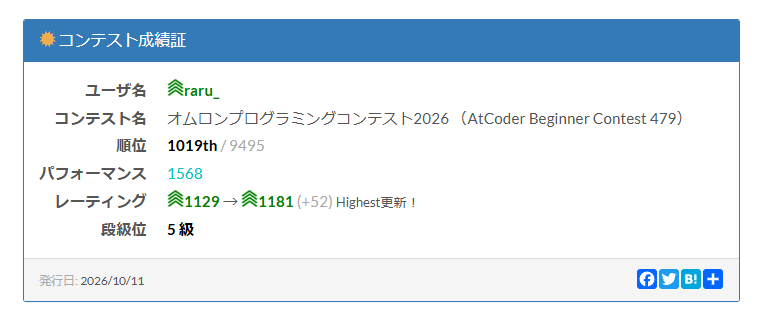

[オムロンプログラミングコンテスト2026 （AtCoder Beginner Contest 479）](https://atcoder.jp/contests/abc479) に参加していました！  
結果は A~E の5完で、順位は1019位でした。以下振り返りです。



## A - Odd Index Sum
[問題](https://atcoder.jp/contests/abc479/tasks/abc479_a)

問題文の通りに。

<details>
<summary>提出コード</summary>

```cpp
#include <bits/stdc++.h>
#define endl '\n'
using namespace std;
using ll = long long;

int main() {
    cin.tie(nullptr);
    ios_base::sync_with_stdio(false);

    ll N;
    cin >> N;
    vector<ll> A(N);
    for (int i = 0; i < N; i++) cin >> A[i];

    ll ans = 0;
    for (int i = 0; i < N; i += 2) ans += A[i];

    cout << ans << endl;
    return 0;
}
```
</details>

## B - Longest Rainy Streak
[問題](https://atcoder.jp/contests/abc479/tasks/abc479_b)

`vector<pair<char,ll>>` の形でランレングス圧縮してから、`R` の長さが最大のものを出力する方針で実装しました。

<details>
<summary>提出コード</summary>

```cpp
#include <bits/stdc++.h>
#define endl '\n'
using namespace std;
using ll = long long;

int main() {
    cin.tie(nullptr);
    ios_base::sync_with_stdio(false);

    ll N;
    cin >> N;
    string S;
    cin >> S;

    vector<pair<char,ll>> rle;
    rle.push_back(make_pair(S[0], 1));
    for (int i = 1; i < N; i++) {
        if (S[i] == rle.back().first) {
            rle.back().second++;
        } else {
            rle.push_back(make_pair(S[i], 1));
        }
    }

    ll len = rle.size();
    ll ans = 0;
    for (int i = 0; i < len; i++) {
        if (rle[i].first == 'R') ans = max(ans, rle[i].second);
    }
    cout << ans << endl;
    return 0;
}
```
</details>

## C - Bento Packing
[問題](https://atcoder.jp/contests/abc479/tasks/abc479_c)

$N \leq 20$ と小さいので、各おかずについて選ぶ・選ばないが全探索できそうです。bit全探索でよしなにやります。

<details>
<summary>提出コード</summary>

```cpp
#include <bits/stdc++.h>
#define endl '\n'
using namespace std;
using ll = long long;

int main() {
    cin.tie(nullptr);
    ios_base::sync_with_stdio(false);

    ll N, W;
    cin >> N >> W;
    vector<ll> A(N), B(N);
    for (int i = 0; i < N; i++) cin >> A[i] >> B[i];

    ll ans = 0;
    for (int bit = 0; bit < (1<<N); bit++) {
        ll w_sum = 0;
        ll a_sum = 0;
        for (int i = 0; i < N; i++) {
            if ((bit >> i) & 1) {
                w_sum += B[i];
                a_sum += A[i];
            }
        }
        if (w_sum <= W) ans = max(ans, a_sum);
    }

    cout << ans << endl;

    return 0;
}
```
</details>

## D - Back and Forth Distance
[問題](https://atcoder.jp/contests/abc479/tasks/abc479_d)

例えばクエリが $s < t$ のとき、どんな移動経路があるのか考えてみます。

マス $s$ から右側に移動するなら、直接マス $t$ に移動するのが一番コストが小さく済みそうです。
そうでなく左側に移動するなら、そこから2連続で左側に移動することは無駄に感じます（2回目の移動で到着したマスに1回目の移動で到着すればコストを改善できるため）。

具体的にどのマスに行くかはさておき、左側には高々1回しか移動しなさそうです。  
一度左側に動いたあとは右側に移動するしかないので、そこからは直接マス $t$ に移動するのが最適です。

よって答えは $\min(R_s, L_s + \min(R_1, R_2, \dotsc, R_{s-1}))$ です。クエリが $s > t$ のときも同様で、これと逆のことをします。

<details>
<summary>提出コード</summary>

区間最小値はセグメント木で実装しました。

```cpp
#include <bits/stdc++.h>
#include <atcoder/segtree>
using namespace atcoder;
#define endl '\n'
using namespace std;
using ll = long long;

const ll INF = 1LL << 60;

ll op(ll a, ll b) {
    return min(a, b);
}

ll e() {
    return INF;
}

int main() {
    cin.tie(nullptr);
    ios_base::sync_with_stdio(false);

    ll N, Q;
    cin >> N >> Q;
    vector<ll> L(N, 0), R(N, 0);
    for (int i = 1; i < N; i++) cin >> L[i];
    for (int i = 0; i < N-1; i++) cin >> R[i];

    segtree<ll, op, e> l_seg(L), r_seg(R);

    while (Q--) {
        ll s, t;
        cin >> s >> t;
        s--;
        t--;
        if (s < t) {
            ll ans = R[s];
            if (s >= 1) ans = min(ans, L[s] + r_seg.prod(0, s));
            cout << ans << endl;
        }
        else {// t < s
            ll ans = L[s];
            if (s < N-1) ans = min(ans, R[s] + l_seg.prod(s+1, N));
            cout << ans << endl;
        }
    }

    return 0;
}
```
</details>

## E - Cut and Add
[問題](https://atcoder.jp/contests/abc479/tasks/abc479_e)

まず、辺 $i$ を取り除いた後の2つの連結成分のサイズをどう求めたらいいか考えました。

ここで、木を頂点 $1$ を根とする根付き木だとして、 $\text{size}[v]$ を頂点 $v$ の部分木に含まれる頂点の数とすると、頂点 $v$ とその親を繋ぐ辺を取り除いた後の2つの連結成分のサイズは、それぞれ $\text{size}[1] - \text{size}[v]$ と $\text{size}[v]$ です。

部分木に含まれる頂点数は帰りがけ順の DFS などで求められるので、連結成分のサイズの比較はできそうですね。

次に厄介なのが変数 $x_v$ への加算ですが、ある部分木に含まれる全頂点に $i$ を加算することは、オイラーツアーテクニックを利用して **「列のある区間に $i$ を加算する」** ことへ言い換えられそうです。

区間に対する加算は imos 法の要領で処理すると $O(N)$ で計算できます。後はこれらをよしなに実装すればACできそうです。

<details>
<summary>提出コード</summary>

```cpp
#include <bits/stdc++.h>
#define endl '\n'
using namespace std;
using ll = long long;

int main() {
    cin.tie(nullptr);
    ios_base::sync_with_stdio(false);

    ll N;
    cin >> N;
    vector<ll> A(N-1), B(N-1);
    for (int i = 0; i < N-1; i++) {
        cin >> A[i] >> B[i];
        A[i]--;
        B[i]--;
    }

    vector<vector<ll>> g(N);
    for (int i = 0; i < N-1; i++) {
        g[A[i]].push_back(B[i]);
        g[B[i]].push_back(A[i]);
    }

    vector<ll> in(N), out(N), siz(N, 0), dist(N, 0);
    ll tour_size = 0;
    {// euler tour
        auto dfs = [&](auto self, ll v, ll from, ll d) -> void {
            dist[v] = d;
            siz[v] = 1;
            in[v] = tour_size++;
            for (auto nv : g[v]) {
                if (nv != from) {
                    self(self, nv, v, d+1);
                    siz[v] += siz[nv];
                }
            }
            out[v] = tour_size++;
        };
        dfs(dfs, 0, -1, 0);
    }

    vector<ll> imos(tour_size+9, 0);
    for (int i = 0; i < N-1; i++) {
        ll p = A[i];
        ll c = B[i];
        if (dist[p] > dist[c]) swap(p, c);
        ll parent_size = siz[0] - siz[c];
        ll child_size = siz[c];
        if (parent_size < child_size) {
            imos[in[c]] += (i+1);
            imos[out[c]] -= (i+1);
        }
        else {
            imos[in[0]] += (i+1);
            imos[out[0]] -= (i+1);
            imos[in[c]] -= (i+1);
            imos[out[c]] += (i+1);
        }
    }

    for (int i = 1; i < tour_size+9; i++) imos[i] += imos[i-1];

    for (int i = 0; i < N; i++) cout << imos[in[i]] << endl;

    return 0;
}
```
</details>

## F - Narrow Passage
[問題](https://atcoder.jp/contests/abc479/tasks/abc479_f)

全くわかりませんでした…。

## 総括
パフォーマンスは1568、レーティングは1129→1181(+52)となりました。  
E問題まで35分ものスピードで通したのは初めてのことで、早解きが上手になってきたかもしれません。もうすぐ入水が見えてきて震えています…。
