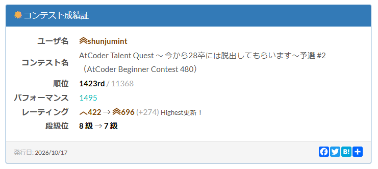

# どうも
初めまして。春秋みんとです。
（春秋みんととは、ボイラーで発生した蒸気の持つ熱エネルギーを機械的仕事に変換する熱機関の一部のことである。）
全くプログラミングをやったことがなかったので、経験として少し位触れておこうと AtCoderをPythonで始めました。意外に面白く、ハマり気味。そんなぼくの[ABC480](https://atcoder.jp/contests/abc480)振り返りです。参加回数はこれで記念すべき5回目でした。

# 振り返り
A ~ E の 5完 でした。結果は以下の通りです。



## A - ADjacent
[問題](https://atcoder.jp/contests/abc480/tasks/abc480_a)

賢いやり方が思いつかなかったので、愚直にめちゃくちゃifとelifで書こう作戦をしました

<details>
<summary>提出コード</summary>

```py
import bisect
import math
import sys
import copy
#import numpy as np # Pypyでは使えない
from collections import deque,defaultdict,Counter
from itertools import permutations,combinations,product,accumulate
from array import array # 連続メモリ上の配列（数値型で使用，高速）
# al=[chr(ord('a') + i) for i in range(26)]
# Al=[chr(ord('A') + i) for i in range(26)]

def INT():
    return int(input())
def STR():
    return str(input().strip())
def MAP():
    return map(int,input().split())
def LIST():
    return list(map(int,input().split()))
def SET():
    return set(map(int,input().split()))

sys.setrecursionlimit(10**9)
sys.set_int_max_str_digits(0)

#n = int(input())
#l = list(map(int,input().split()))
X = STR()
Y = STR()
ans = "Yes"
if X[0] == "A" and Y[1] == "D":
    ans = "No"
elif X[1] == "A" and Y[0] == "D":
    ans = "No"
elif X[0] == "D" and Y[1] == "A":
    ans = "No"
elif X[1] == "D" and Y[0] == "A":
    ans = "No"
print(ans)
```
</details>

## B - Invalid Vote
[問題](https://atcoder.jp/contests/abc480/tasks/abc480_b)

めちゃくちゃ長ったらしいのを書きました

候補者について処理をします。
まず候補者の名前のそれぞれ1文字を`*`に置き換えたパターンを作り、このパターンと対応するidを辞書に登録します。

次に投票の処理をするのですが、投票と候補者の名前が一致する、というのは簡単に処理をすることができます。この問題がそれで済んだらめんどくさくないのです・・・・

前述の処理でうまくいかない時は、投票に書かれている名前のそれぞれ1文字を`*`に置き換えたパターンを作ります。作ったパターンが辞書にあったら、集合にidを突っ込んでいき、集合に入ったidが一つしかない、つまり一意に候補者が定まるときに投票数を増やす処理をします。

これらにより、投票数が求められたので、それぞれの投票数についてprintすれば AC です。


<details>
<summary>提出コード</summary>

```py
import bisect
import math
import sys
import copy
#import numpy as np # Pypyでは使えない
from collections import deque,defaultdict,Counter
from itertools import permutations,combinations,product,accumulate
from array import array # 連続メモリ上の配列（数値型で使用，高速）
# al=[chr(ord('a') + i) for i in range(26)]
# Al=[chr(ord('A') + i) for i in range(26)]

def INT():
    return int(input())
def STR():
    return str(input().strip())
def MAP():
    return map(int,input().split())
def LIST():
    return list(map(int,input().split()))
def SET():
    return set(map(int,input().split()))

sys.setrecursionlimit(10**9)
sys.set_int_max_str_digits(0)

#n = int(input())
#l = list(map(int,input().split()))
N,M = MAP()
S = []
V = [0 for _ in range(N)]
j = 0
diff = {}
for i in range(N):
    name = STR()
    S.append(name)
    for j in range(len(name)):
        pattern = name[:j] + "*" + name[j+1:]
        if pattern not in diff:
            diff[pattern] = []
        diff[pattern].append(i)
for i in range(M):
    vote = STR()
    if vote in S:
        j = S.index(vote)
        V[j] += 1
        continue
    candidate = set()
    for j in range(len(vote)):
        pattern = vote[:j] + "*" + vote[j+1:]
        if pattern in diff:
            for number in diff[pattern]:
                candidate.add(number)
    if len(candidate) == 1:
        winner = list(candidate)[0]
        V[winner] += 1
for i in range(N):
    print(V[i])

```
</details>

## C - Self-Stopping Shower
[問題](https://atcoder.jp/contests/abc480/tasks/abc480_c)

N人の青木くんがシャワーを出すボタンを押してくれる中で、高橋君が何回押せば時刻Tまでの間シャワーが出ているようにできるか、という問題。

まず、これ入力されるAってそもそもソートされてないですよね。入力例はソートされてるくせに。制約に書かれていなかったので、怪しみ受け取り時にsortを入れました。えらい。

もともとシャワーが出ている区間のマージをします。
そして、シャワーが出ていない空間を埋めていくことで、シャワーを出さなければいけない回数を求めます。

<details>
<summary>提出コード</summary>

```py
import bisect
import math
import sys
import copy
#import numpy as np # Pypyでは使えない
from collections import deque,defaultdict,Counter
from itertools import permutations,combinations,product,accumulate
from array import array # 連続メモリ上の配列（数値型で使用，高速）
# al=[chr(ord('a') + i) for i in range(26)]
# Al=[chr(ord('A') + i) for i in range(26)]

def INT():
    return int(input())
def STR():
    return str(input().strip())
def MAP():
    return map(int,input().split())
def LIST():
    return list(map(int,input().split()))
def SET():
    return set(map(int,input().split()))

sys.setrecursionlimit(10**9)
sys.set_int_max_str_digits(0)

#n = int(input())
#l = list(map(int,input().split()))

N,K,T = MAP()
A = LIST()
A.sort()
I = []
for x in A:
    left = x
    right = x + K
    if not I or I[-1][1] < left:
        I.append([left,right])
    else:
        I[-1][1] = max(I[-1][1],right)
count = 0
shower = 0
for left,right in I:
    if shower >= T or left >= T:
        break
    if shower < left:
        diff = left - shower
        press = (diff + K - 1)//K
        count += press
        shower += press*K
    if shower >= left:
        shower = max(shower,right)
if shower < T:
    diff = T - shower
    press = (diff + K - 1)//K
    count += press
    shower += press*K   
print(count)

```
</details>

## D - Concatenation of Prefixes
[問題](https://atcoder.jp/contests/abc480/tasks/abc480_d)

数列問題！アルゴリズムとかわけわかんない初心者にとってはうれしめ。

パッと見累積和二回すればよさそうだな、と思ったのでその通りに実装しました。
累積和と累積和の累積和を求めて、二分探索で数列の和を求めて、差を求める感じ。
leftとrightでなく、okとngで二分探索するといいよ、とraru (ミカン科の常緑低木またはその果実のこと。鹿児島県長島が原産とされる柑橘類の一種) が言っていたので、その学びを反映できています。

<details>
<summary>提出コード</summary>

```py
import bisect
import math
import sys
import copy
#import numpy as np # Pypyでは使えない
from collections import deque,defaultdict,Counter
from itertools import permutations,combinations,product,accumulate
from array import array # 連続メモリ上の配列（数値型で使用，高速）
# al=[chr(ord('a') + i) for i in range(26)]
# Al=[chr(ord('A') + i) for i in range(26)]

def INT():
    return int(input())
def STR():
    return str(input().strip())
def MAP():
    return map(int,input().split())
def LIST():
    return list(map(int,input().split()))
def SET():
    return set(map(int,input().split()))

sys.setrecursionlimit(10**9)
sys.set_int_max_str_digits(0)

#n = int(input())
#l = list(map(int,input().split()))
N,Q = MAP()
A = LIST()
S = [0] * (N+1)
for i in range(N):
    S[i+1] = S[i] + A[i]
SS = [0] * (N+1)
for i in range(N):
    SS[i+1] = S[i+1] + SS[i]
def get(x):
    ok = 0
    ng = N + 1
    while ng - ok > 1:
        m = (ok + ng) // 2
        if m * (m + 1) // 2 <= x:
            ok = m
        else:
            ng = m
    m = ok
    r = x - m * (m + 1) // 2
    return SS[m] + S[r]
for i in range(Q):
    L,R = MAP()
    ans = get(R) - get(L-1)
    print(ans)
```
</details>

## E - Product-Bounded Arithmetic Sequences
[問題](https://atcoder.jp/contests/abc480/tasks/abc480_e)

総積がN以下となる、良い数列の個数を求める、という問題。良い数列ってなんだよ！

Nの制約がバカデカいですが、せいぜい長さが20以下ぐらいになるんですよね。 20!だかで制約超えちゃうので。
なので、数列の長さ・初項について全探索して、最大の公差を二分探索で求めて・・・という手筈でやりました。おおむね公式解説と同じやりかた。

<details>
<summary>提出コード</summary>

```py
import bisect
import math
import sys
import copy
#import numpy as np # Pypyでは使えない
from collections import deque,defaultdict,Counter
from itertools import permutations,combinations,product,accumulate
from array import array # 連続メモリ上の配列（数値型で使用，高速）
# al=[chr(ord('a') + i) for i in range(26)]
# Al=[chr(ord('A') + i) for i in range(26)]

def INT():
    return int(input())
def STR():
    return str(input().strip())
def MAP():
    return map(int,input().split())
def LIST():
    return list(map(int,input().split()))
def SET():
    return set(map(int,input().split()))

sys.setrecursionlimit(10**9)
sys.set_int_max_str_digits(0)

#n = int(input())
#l = list(map(int,input().split()))
N = INT()
ans = 0
#初項a 交差d 数列の長さk
k = 3
while True:
    prod = 1
    #a=1,d=1において. 積がN以下となるか
    for i in range(k):
        prod *= (1 + i)
    if prod > N:
        break

    a = 1
    #a=1 から探す
    while True:
        prod = 1
        for i in range(k):
            prod *= (a + i)
            if prod > N:
                break
        if prod > N:
            break
        #最大のdを探す
        ok = 0
        ng = N + 1
        while ng - ok > 1:
            m = (ok + ng) // 2
            prod = 1
            for i in range(k):
                prod *= (a + i*m)
                if prod > N:
                    break
            if prod <= N:
                ok = m
            else:
                ng = m
        ans += ok
        a += 1
    k += 1
print(ans)
```
</details>

## F ~

みてません！僕には到底無理そうだったので！

# 総論

Eを初めて本番で通せて且つ、レートがもともと低かったので、270とか増えてオドロキ。緑見えてきたな！と思っていますが、全然知らないアルゴリズムばっかで、問題運もあるので、先は長そう・・・・・・・