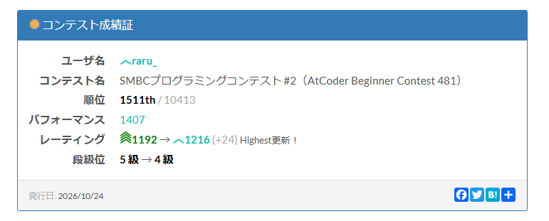
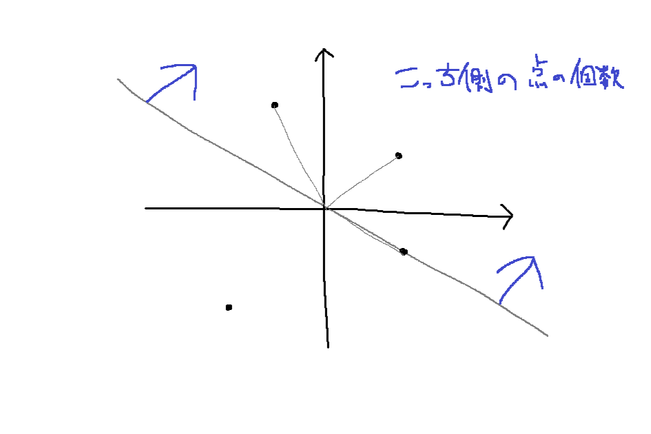
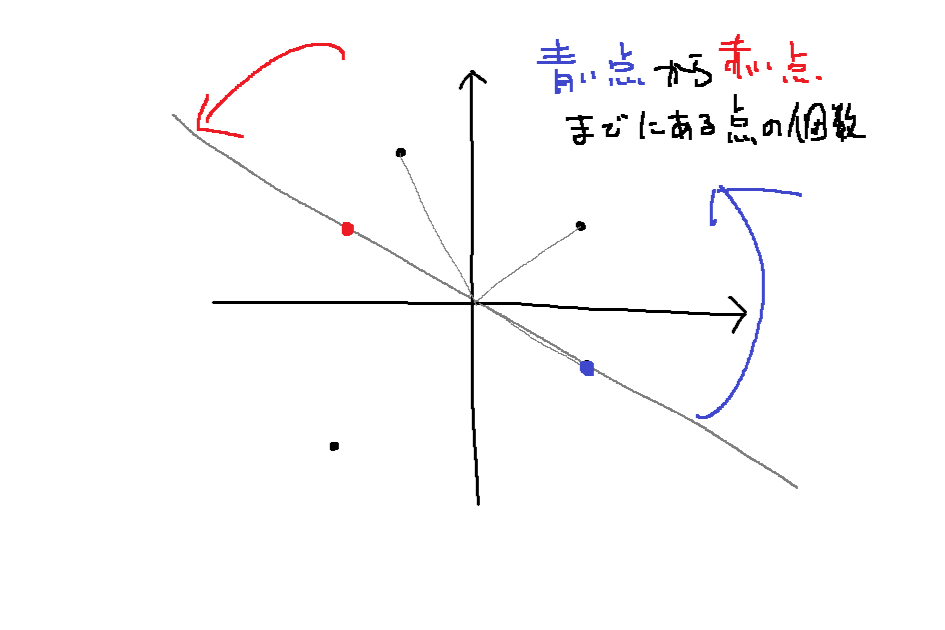

[SMBCプログラミングコンテスト #2（AtCoder Beginner Contest 481）](https://atcoder.jp/contests/abc481) に参加していました！  
結果は A~E の5完で、順位は1511位でした。以下振り返りです。



## A - Digits of A+B
[問題](https://atcoder.jp/contests/abc481/tasks/abc481_a)

$A + B$ を文字列にしたものの長さを出力する方針でやります。

<details>
<summary>提出コード</summary>

```cpp
#include <bits/stdc++.h>
#define endl '\n'
using namespace std;
using ll = long long;

int main() {
    cin.tie(nullptr);
    ios_base::sync_with_stdio(false);

    ll A, B;
    cin >> A >> B;

    ll sum = A + B;
    string s = to_string(sum);

    cout << s.size() << endl;
    return 0;
}
```
</details>

## B - Polyline
[問題](https://atcoder.jp/contests/abc481/tasks/abc481_b)

各 $i$ について $A_i \leq K \leq A_{i+1}$ もしくは $A_{i+1} \leq K \leq A_i$ を満たすときに数える方針で実装しました。が、サンプル1が通りません。考え直すと $y$ 座標が $K$ であるような点では二重で数えてしまっていたため、そういう点の個数だけ答えから減らすことにします。

<details>
<summary>提出コード</summary>

```cpp
#include <bits/stdc++.h>
#define endl '\n'
using namespace std;
using ll = long long;

int main() {
    cin.tie(nullptr);
    ios_base::sync_with_stdio(false);

    ll N, K;
    cin >> N >> K;
    vector<ll> A(N);
    for (int i = 0; i < N; i++) cin >> A[i];

    ll ans = 0;
    for (int i = 0; i < N-1; i++) {
        ll a = A[i];
        ll na = A[i+1];
        if (a > na) swap(a, na);
        if (a <= K && K <= na) ans++;
    }
    for (int i = 1; i < N-1; i++) {
        if (A[i] == K) ans--;
    }

    cout << ans << endl;
    return 0;
}
```
</details>

## C - Bank Accounts
[問題](https://atcoder.jp/contests/abc481/tasks/abc481_c)

久しぶりにコワスギ銀行の問題を見た気がする！

文字列 $s$ の存在判定や、そのペアとなる数値を取得できるデータ構造があれば十分そうです。 `std::unordered_map` を使って問題文の通りに実装します。最小の正整数を取るために `std::set` を用いて実装して楽しようとしたけど、今思えば逆に複雑な実装になってしまったような気がする…。

<details>
<summary>提出コード</summary>

```cpp
#include <bits/stdc++.h>
#define endl '\n'
using namespace std;
using ll = long long;

int main() {
    cin.tie(nullptr);
    ios_base::sync_with_stdio(false);

    ll Q;
    cin >> Q;

    set<ll> aki;
    for (int i = 1; i <= 300009; i++) aki.insert(i);

    unordered_map<string, ll> used;

    while (Q--) {
        string S;
        cin >> S;
        if (used.count(S)) {
            cout << used[S] << endl;
        }
        else {
            ll mex = *aki.begin();
            aki.erase(mex);
            used[S] = mex;
            cout << mex << endl;
        }
    }

    return 0;
}
```
</details>

## D - Autopilot
[問題](https://atcoder.jp/contests/abc481/tasks/abc481_d)

辺の重みが $0$ か $1$ の有向グラフ上で最短経路問題を解けばよさそうで、これは 01-BFS で解けそうです。が、如何せん 01-BFS を書くのが久々で実装に手間取ってしまいました。サンプルは通ったものの [WA](https://atcoder.jp/contests/abc481/submissions/80318412) が出てしまったので、冷静に図を描いて実装をもういちど整理します。

実装を見直すと、本来はコスト $0$ で到達できるはずの頂点に先にコスト $1$ で遷移してしまって、それを最小コストだと確定してしまう状況がありそうです。一発で通せなかったのもあり上手に修正できる自信がなかったので、書き慣れているダイクストラ法に修正して提出。

問題を読んで 01-BFS だとすぐ気付いたためか、かえって 01-BFS で書くことに固執してしまっていたのが反省点。書き慣れている実装に寄せて認知負荷を下げていくスキルも必要だなと感じますね…。

<details>
<summary>提出コード</summary>

```cpp
#include <bits/stdc++.h>
#define endl '\n'
using namespace std;
using ll = long long;

int main() {
    cin.tie(nullptr);
    ios_base::sync_with_stdio(false);

    ll N, M, S, T;
    cin >> N >> M >> S >> T;
    S--;
    T--;
    vector<vector<ll>> g(N);
    for (int i = 0; i < M; i++) {
        ll a, b;
        cin >> a >> b;
        a--;
        b--;
        g[a].push_back(b);
    }

    for (int i = 0; i < N; i++) {
        sort(g[i].begin(), g[i].end());
    }

    const ll INF = 1LL << 60;
    vector<ll> dist(N, INF);

    using P = pair<ll,ll>; // dist, v
    priority_queue<P, vector<P>, greater<P>> pq;
    pq.emplace(0, S);

    while (pq.size()) {
        auto [d, v] = pq.top();
        pq.pop();
        if (dist[v] <= d) continue;
        dist[v] = d;
        for (int ni = 0; ni < g[v].size(); ni++) {
            ll nv = g[v][ni];
            if (ni == 0) {
                if (dist[nv] > dist[v]) {
                    pq.emplace(dist[v], nv);
                }
            }
            else {
                if (dist[nv] > dist[v] + 1) {
                    pq.emplace(dist[v] + 1, nv);
                }
            }
        }
    }

    if (dist[T] == INF) {
        cout << -1 << endl;
    } else {
        cout << dist[T] << endl;
    }
    return 0;
}
```
</details>

## E - Most Brilliant Starry Sky
[問題](https://atcoder.jp/contests/abc481/tasks/abc481_e)

苦手な幾何が見えてそっと閉じたくなりましたが、読み進めると案外解けないこともなさそうなので、気合いで取り組みます。

図を描いて考えると、「点 $(X_i, Y_i)$ から反時計回り（または時計回り）に角度の幅が $180^\circ$ 未満を満たす限り進んだ時、道中でいくつの点を通過するか？」が分かればよくて、求める答えはこれをすべての $i$ に対して解いた時の最大値だと言えそうです。ですが、「角度の幅が $180^\circ$ 未満か」を判定する方法が分からず悩みました…。

いろいろ考えていると、点 $(X_i, Y_i)$ から進んでいって角度の幅が $180^\circ$ となるのは点 $(-X_i, -Y_i)$ の方向まで進んだ時なので、「点 $(X_i, Y_i)$ から反時計回り（または時計回り）に点 $(-X_i, -Y_i)$ まで進んだ時、道中でいくつの点を通過するか？」が分かればよいと気付きます。これはある点 $(X_i, Y_i)$ から点 $(-X_i, -Y_i)$ への区間に対して点の総数を求めるクエリの形になっているので、あらかじめ与えられた点を偏角でソートしておくことで、累積和や BIT などを構築できて答えられそうです。





<details>
<summary>提出コード</summary>

```cpp
#include <bits/stdc++.h>
#define endl '\n'
using namespace std;
using ll = long long;

// from https://github.com/rarula/atcoder-templates
struct Point {
    ll x;
    ll y;
    bool original;
    ll idx;
};

ll cross(const Point& a, const Point& b) {
    return a.x * b.y - b.x * a.y;
}

bool cmp(const Point& a, const Point& b) {
    bool isTopA = a.y > 0 || (a.y == 0 && a.x > 0);
    bool isTopB = b.y > 0 || (b.y == 0 && b.x > 0);
    if (isTopA != isTopB) return !isTopA && isTopB;
    return cross(a, b) > 0;
}

// 原点の偏角は定義されないため、(0, 0) は入力に含まれないようにする
void polar_angle_sort(vector<Point> &points) {
    sort(points.begin(), points.end(), cmp);
}


void solve() {
    ll N;
    cin >> N;
    vector<ll> X(N), Y(N);
    for (int i = 0; i < N; i++) cin >> X[i] >> Y[i];

    vector<Point> points;
    for (int i = 0; i < N; i++) {
        points.push_back({ X[i], Y[i], true, i });
        points.push_back({ -X[i], -Y[i], false, i });
    }
    polar_angle_sort(points);

    ll len = points.size();

    vector<pair<ll,ll>> prefix_sum(len); // 実際, 反転
    for (int i = 0; i < len; i++) {
        auto [x, y, original, idx] = points[i];
        if (original) {
            prefix_sum[i].first++;
        } else {
            prefix_sum[i].second++;
        }
    }
    for (int i = 1; i < len; i++) {
        prefix_sum[i].first += prefix_sum[i-1].first;
        prefix_sum[i].second += prefix_sum[i-1].second;
    }

    vector<pair<ll,ll>> ori(N), mir(N);
    for (int i = 0; i < len; i++) {
        auto [x, y, original, idx] = points[i];
        if (original) {
            ori[idx] = prefix_sum[i];
        } else {
            mir[idx] = prefix_sum[i];
        }
    }

    ll ans = 0;
    for (int i = 0; i < N; i++) {
        pair<ll,ll> a = ori[i];
        pair<ll,ll> b = mir[i];
        if (a < b) {
            ll cnt = b.first - a.first;
            ans = max({ans, cnt, N - cnt});
            ans = max({ans, cnt + 1, N - cnt - 1});
        }
        else {
            ll cnt = a.first - b.first;
            ans = max({ans, cnt, N - cnt});
            ans = max({ans, cnt - 1, N - cnt + 1});
        }
    }

    cout << ans << endl;
}

int main() {
    cin.tie(nullptr);
    ios_base::sync_with_stdio(false);

    ll T;
    cin >> T;
    while (T--) {
        solve();
    }

    return 0;
}
```
</details>

## F - Evil Shortest Path
[問題](https://atcoder.jp/contests/abc481/tasks/abc481_f)

Eを通して残り25分程度だったのですが、この時点で ac-predictor による予測値が入水を示していて、順位表が気になって全く手に付きませんでした。残り5分ほどで「DFSで辞書順に進んだら最少スコアなんじゃないか！？」と大嘘を書くなどしましたが、もちろんサンプルが通らず終了。

## 総括
パフォーマンスは1407、レーティングは1192→1216(+24)となりました。 **ついに入水！！！！！**  
これまで勝率0%だった幾何問題を初めてコンテスト中に通せたりと、嬉しいことが重なる回でした。ひとまず目標だった水色になれて一安心。よかった！！！
