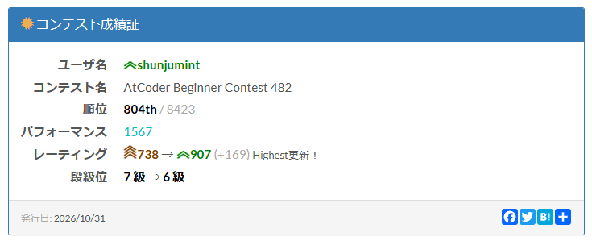

# どうも
初めまして。春秋みんとです。（春秋みんととは、ミズキ目アジサイ科アジサイ属の落葉性灌木の一種である。）
今回こそは入緑するぞ！の気概を見せた[ABC482](https://atcoder.jp/contest/abc482)の振り返り記事です。


# 振り返り
A ~ E の 5完 でした。結果は以下の通りです。



## A - Nigiri
[問題](https://atcoder.jp/contests/abc482/tasks/abc482_a)

oと.のみからなる文字列Sの中のoの個数を数え、奇数もしくは偶数かを判定します。

<details>
<summary>提出コード</summary>

```py
import bisect
import math
import sys # Codonでは使えない
import heapq
import copy
#import numpy as np # Pypyでは使えない Codon独自のNumPy実装
from collections import deque,defaultdict,Counter
from itertools import permutations,combinations,product,accumulate
from array import array # 連続メモリ上の配列（数値型で使用，高速）Codonでは使えない
# al=[chr(ord('a') + i) for i in range(26)]
# Al=[chr(ord('A') + i) for i in range(26)]

def INT():
    return int(input())
def STR():
    return str(input().strip())
def MAP():
    return list(map(int, input().split()))
def LIST():
    return list(map(int,input().split()))
def SET():
    return set(map(int,input().split()))

sys.setrecursionlimit(10**9)
sys.set_int_max_str_digits(0)

#Codonではintは64bit整数！オーバーフローしそうなら i128にする！
#Codonでは除算方向は負の無限大に丸めるのでなく、0

#n = int(input())
#l = list(map(int,input().split()))
S = STR()
ans = S.count("o")
if ans % 2 == 1:
    print("odd")
else:
    print("even")
```
</details>

## B - Blank Bingo
[問題](https://atcoder.jp/contests/abc482/tasks/abc482_b)

5×5のマスで、印がついているときo、ついていない時.が与えられているので、ビンゴになるように最小の個数の印をつけます。横、縦、斜めについて全部確かめていきます。

<details>
<summary>提出コード</summary>

```py
import bisect
import math
import sys # Codonでは使えない
import heapq
import copy
#import numpy as np # Pypyでは使えない Codon独自のNumPy実装
from collections import deque,defaultdict,Counter
from itertools import permutations,combinations,product,accumulate
from array import array # 連続メモリ上の配列（数値型で使用，高速）Codonでは使えない
# al=[chr(ord('a') + i) for i in range(26)]
# Al=[chr(ord('A') + i) for i in range(26)]

def INT():
    return int(input())
def STR():
    return str(input().strip())
def MAP():
    return list(map(int, input().split()))
def LIST():
    return list(map(int,input().split()))
def SET():
    return set(map(int,input().split()))

sys.setrecursionlimit(10**9)
sys.set_int_max_str_digits(0)

#Codonではintは64bit整数！オーバーフローしそうなら i128にする！
#Codonでは除算方向は負の無限大に丸めるのでなく、0

#n = int(input())
#l = list(map(int,input().split()))

S = [STR() for _ in range(5)]
ans = 5
for i in range(5):
    cnt = S[i].count(".")
    if cnt < ans:
        ans = cnt
for i in range(5):
    ver = [S[x][i] for x in range(5)]
    cnt = ver.count(".")
    if cnt < ans:
        ans = cnt
dia1 = [S[x][x] for x in range(5)]
cnt = dia1.count(".")
if cnt < ans:
    ans = cnt
dia2 = [S[x][4-x] for x in range(5)]
cnt = dia2.count(".")
if cnt < ans:
    ans = cnt
print(ans)
```
</details>

## C - Band Count
[問題](https://atcoder.jp/contests/abc482/tasks/abc482_c)

HとWの制約がどえらいデカいのに気づかずに、累積和で処理しようとして二回RE。ヘマした後にこれに気づいたため、方針を変更。
リストを作製し、駒がある列と行を追加していき、ソートして、二分探索で計算していきます。

<details>
<summary>提出コード</summary>

```py
import bisect
import math
import sys # Codonでは使えない
import heapq
import copy
#import numpy as np # Pypyでは使えない Codon独自のNumPy実装
from collections import deque,defaultdict,Counter
from itertools import permutations,combinations,product,accumulate
from array import array # 連続メモリ上の配列（数値型で使用，高速）Codonでは使えない
# al=[chr(ord('a') + i) for i in range(26)]
# Al=[chr(ord('A') + i) for i in range(26)]

def INT():
    return int(input())
def STR():
    return str(input().strip())
def MAP():
    return list(map(int, input().split()))
def LIST():
    return list(map(int,input().split()))
def SET():
    return set(map(int,input().split()))

sys.setrecursionlimit(10**9)
sys.set_int_max_str_digits(0)

#Codonではintは64bit整数！オーバーフローしそうなら i128にする！
#Codonでは除算方向は負の無限大に丸めるのでなく、0

#n = int(input())
#l = list(map(int,input().split()))
H,W,N,Q = MAP()
Srow = []
Scol = []
for i in range(N):
    R,C = MAP()
    Srow.append(R)
    Scol.append(C)
Srow.sort()
Scol.sort()
for i in range(Q):
    A,B,C = MAP()
    if A == 1:
        print(bisect.bisect_right(Srow,C) - bisect.bisect_left(Srow,B))
    else:
        print(bisect.bisect_right(Scol,C) - bisect.bisect_left(Scol,B))
```
</details>

## D - Wannabe Zombie
[問題](https://atcoder.jp/contests/abc482/tasks/abc482_d)

わっはー、we're zombie zombie・・・　な問題です。
端の人がゾンビになったときは $\frac{X_N - X_1}{2}$ ですね。
そして、それ以外の人kについては隣の人k-1かk+1をゾンビにして、それぞれ分担してゾンビ化させていくと、すべての人をゾンビにできますね。どっちの人をゾンビにすればいいかをチェックすれば問題ないです。

<details>
<summary>提出コード</summary>

```py
import bisect
import math
import sys # Codonでは使えない
import heapq
import copy
#import numpy as np # Pypyでは使えない Codon独自のNumPy実装
from collections import deque,defaultdict,Counter
from itertools import permutations,combinations,product,accumulate
from array import array # 連続メモリ上の配列（数値型で使用，高速）Codonでは使えない
# al=[chr(ord('a') + i) for i in range(26)]
# Al=[chr(ord('A') + i) for i in range(26)]

def INT():
    return int(input())
def STR():
    return str(input().strip())
def MAP():
    return list(map(int, input().split()))
def LIST():
    return list(map(int,input().split()))
def SET():
    return set(map(int,input().split()))

sys.setrecursionlimit(10**9)
sys.set_int_max_str_digits(0)

#Codonではintは64bit整数！オーバーフローしそうなら i128にする！
#Codonでは除算方向は負の無限大に丸めるのでなく、0

#n = int(input())
#l = list(map(int,input().split()))
N = INT()
X = LIST()
for i in range(N):
    L = X[i] - X[0]
    R = X[-1] - X[i]
    if i == 0 or i == N-1:
        ans = max(X[i] - X[0],X[-1] - X[i])//2
        print(ans)
        continue
    dL = X[i] - X[i-1]
    dR = X[i+1] - X[i]
    ans = min(max(L,R+dL),max(L+dR,R))//2
    print(ans)
```
</details>

## E - Diameter Endpoint Colors
[問題](https://atcoder.jp/contests/abc482/tasks/abc482_e)

これ、進研〇ミで見たところだ！
ABC482の前日、典型90の003をやっていたのですが、ちょうど木の直径を求めるようなプログラムが回答であったため、いったん流用します。
木の直径の中心を求める為、直径の端の頂点同士の経路を考えます。このとき、直径の偶奇で中心が一つの頂点か、二つの頂点になるため、場合分けをしなければなりません。中心が一つの頂点であるとき、異なる枝にある同色のペアを考えます。中心が二つの頂点であるとき、片方の頂点の枝ともう片方の頂点の枝の同色のペアについて考えます。
一旦クソみたいな命名や打ち間違えでWARONGU ANSA-をしてから、そのへんを直し、ACです。
<details>
<summary>提出コード</summary>

```py
import bisect
import math
import sys # Codonでは使えない
import heapq
import copy
#import numpy as np # Pypyでは使えない Codon独自のNumPy実装
from collections import deque,defaultdict,Counter
from itertools import permutations,combinations,product,accumulate
from array import array # 連続メモリ上の配列（数値型で使用，高速）Codonでは使えない
# al=[chr(ord('a') + i) for i in range(26)]
# Al=[chr(ord('A') + i) for i in range(26)]

def INT():
    return int(input())
def STR():
    return str(input().strip())
def MAP():
    return list(map(int, input().split()))
def LIST():
    return list(map(int,input().split()))
def SET():
    return set(map(int,input().split()))

sys.setrecursionlimit(10**9)
sys.set_int_max_str_digits(0)

#Codonではintは64bit整数！オーバーフローしそうなら i128にする！
#Codonでは除算方向は負の無限大に丸めるのでなく、0

#n = int(input())
#l = list(map(int,input().split()))

#AtCoder 典型90 003の自回答より
N = INT()
adj = [[] for _ in range(N+1)]
for i in range(1,N):
    A,B = MAP()
    adj[A].append(B)
    adj[B].append(A)
C = [0] + LIST()
#頂点xからDFSする
def dfs(x):
    dist = [-1] * (N+1)
    parent = [-1] * (N+1)
    dist[x] = 0
    stack = [x]
    while stack:
        i = stack.pop()
        for j in adj[i]:
            if dist[j] == -1:
                stack.append(j)
                dist[j] = dist[i] + 1
                parent[j] = i
    return dist, parent

#頂点1からにする
k,_ = dfs(1)
l = k.index(max(k))

m,parent = dfs(l)
r = m.index(max(m))
D = m[r]

path = []
cur = r
while cur != -1:
    path.append(cur)
    cur = parent[cur]
path.reverse()

ans = 0

if D % 2 == 0:
    center = path[D//2]
    cnt = defaultdict(lambda: defaultdict(int))
    for i in adj[center]:
        stack = [(i,center,1)]
        while stack:
            x,p,d = stack.pop()
            if d == D//2:
                cnt[C[x]][i] += 1
            for j in adj[x]:
                if j != p:
                    stack.append((j,x,d+1))
    for color,groups in cnt.items():
        total = sum(groups.values())
        ans += (total * total - sum(x*x for x in groups.values())) // 2
else:
    a = path[D//2]
    b = path[D//2 + 1]
    def count_colors(s,b):
        cnt = defaultdict(int)
        stack = [(s,b,0)]
        while stack:
            x,p,d = stack.pop()
            if d == D//2:
                cnt[C[x]] += 1
            for j in adj[x]:
                if j != p:
                    stack.append((j,x,d+1))
        return cnt
    L = count_colors(a,b)
    R = count_colors(b,a)
    for color, count in L.items():
        ans += count * R[color]
print(ans)
```
</details>

## F ~

みてません！時間なくて！

# 総論
前回（ABC481）は Atcoder Python Anti Contest (APAC) であったため、Eを通すことができませんでしたが、今回は通りました。やったね。かくして、入緑です。本当に問題運がいい。
典型90をチョロっとやっただけなのですが、やはり問題を解く数だな、と思ったので、しばらく研鑽しようかなと思います。リアル多忙だし。