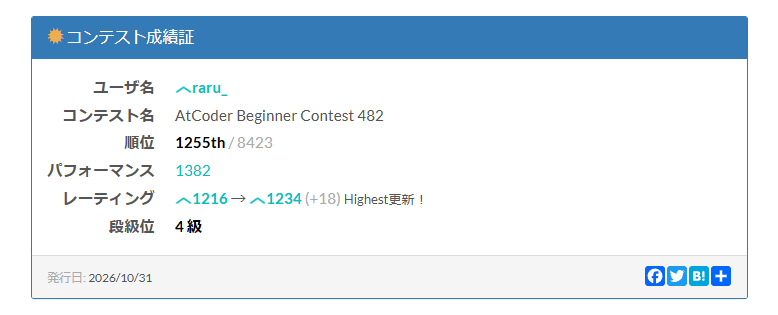
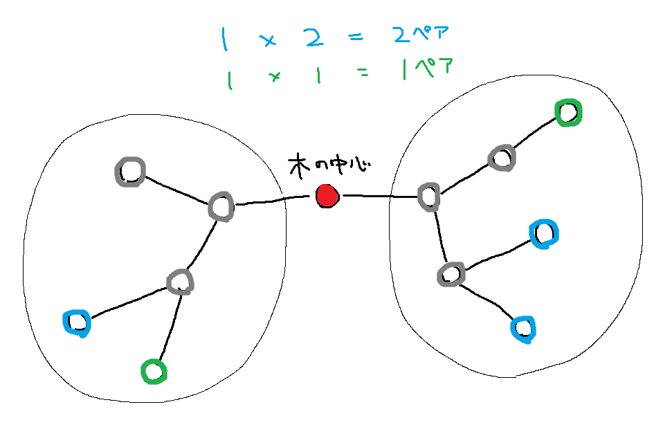

[AtCoder Beginner Contest 482](https://atcoder.jp/contests/abc482) に参加していました！  
結果は A~D の4完で、順位は1255位でした。以下振り返りです。



https://x.com/rarula_/status/2116583539009638571?a=SoSGQ-X_ra9J9I1DuTg&s=20

## A - Nigiri
[問題](https://atcoder.jp/contests/abc482/tasks/abc482_a)

問題文の通りに実装します。なんとなく `.` の個数も数えるように実装して、提出直前に「これ要らないな…」と思って消したりしていました。

<details>
<summary>提出コード</summary>

```cpp
#include <bits/stdc++.h>
#define endl '\n'
using namespace std;
using ll = long long;

int main() {
    cin.tie(nullptr);
    ios_base::sync_with_stdio(false);

    string S;
    cin >> S;

    ll o = 0;
    ll len = S.size();
    for (int i = 0; i < len; i++) {
        if (S[i] == 'o') o++;
    }

    if (o % 2 == 0) {
        cout << "even" << endl;
    } else {
        cout << "odd" << endl;
    }

    return 0;
}
```
</details>

## B - Blank Bingo
[問題](https://atcoder.jp/contests/abc482/tasks/abc482_b)

各方向について全探索。縦・横方向について探索するのは簡単で、斜め方向については2通りしかないため、手で添え字を合わせて実装します。

<details>
<summary>提出コード</summary>

```cpp
#include <bits/stdc++.h>
#define endl '\n'
using namespace std;
using ll = long long;

int main() {
    cin.tie(nullptr);
    ios_base::sync_with_stdio(false);

    vector<string> S(5);
    for (int i = 0; i < 5; i++) cin >> S[i];

    const ll INF = 1LL << 60;
    ll ans = INF;

    for (int i = 0; i < 5; i++) {
        ll cnt = 0;
        for (int j = 0; j < 5; j++) {
            if (S[i][j] == '.') cnt++;
        }
        ans = min(ans, cnt);
    }
    for (int j = 0; j < 5; j++) {
        ll cnt = 0;
        for (int i = 0; i < 5; i++) {
            if (S[i][j] == '.') cnt++;
        }
        ans = min(ans, cnt);
    }
    {
        ll cnt = 0;
        if (S[0][0] == '.') cnt++;
        if (S[1][1] == '.') cnt++;
        if (S[2][2] == '.') cnt++;
        if (S[3][3] == '.') cnt++;
        if (S[4][4] == '.') cnt++;
        ans = min(ans, cnt);
    }
    {
        ll cnt = 0;
        if (S[4][0] == '.') cnt++;
        if (S[3][1] == '.') cnt++;
        if (S[2][2] == '.') cnt++;
        if (S[1][3] == '.') cnt++;
        if (S[0][4] == '.') cnt++;
        ans = min(ans, cnt);
    }

    cout << ans << endl;
    return 0;
}
```
</details>

## C - Band Count
[問題](https://atcoder.jp/contests/abc482/tasks/abc482_c)

制約を確認すると $H, W \leq 10^9$ で、グリッドがかなり大きいのが面倒です。

ひとまず種類1のクエリについて考えます。 $f(i)$ を「 $i$ 行目までに置かれている駒の個数」とすると、クエリ $j$ の答えは $f(d_j) - f(u_j - 1)$ です。つまり $f(i)$ を高速に求められれば解けそうです。

ここで [過去のF問題](https://atcoder.jp/contests/abc477/tasks/abc477_f) を思い出しました。クエリ $j$ の答えは $-f(u_j - 1)$ と $f(d_j)$ という寄与に分けられるので、あらかじめクエリを先読みすることで、以下のイベントを行の昇順に処理する平面走査ができそうです。
- $R_i$ 行目で、変数 $\text{cnt}$ に $1$ 加算する
- $u_j - 1$ 行目で、クエリ $j$ の答えから $\text{cnt}$ だけ減らす
- $d_j$ 行目で、クエリ $j$ の答えに $\text{cnt}$ だけ加える

もっと簡単な方針が立てられそうですが、おそらく正当なので実装することにします。行を列に変えても同じことなので、種類2のクエリについても同じ方針で処理します。

<details>
<summary>提出コード</summary>

```cpp
#include <bits/stdc++.h>
#define endl '\n'
using namespace std;
using ll = long long;

int main() {
    cin.tie(nullptr);
    ios_base::sync_with_stdio(false);

    ll H, W, N, Q;
    cin >> H >> W >> N >> Q;
    vector<ll> R(N), C(N);
    for (int i = 0; i < N; i++) cin >> R[i] >> C[i];

    vector<tuple<ll,ll,ll>> query(Q);
    for (int i = 0; i < Q; i++) {
        ll op, u, d;
        cin >> op >> u >> d;
        query[i] = make_tuple(op, u, d);
    }

    vector<ll> ans(Q, 0);

    {// vertical
        vector<tuple<ll,ll,ll>> event; // y, type (0 = koma, 1 = query_begin, 2 = query_end), query_index
        for (int i = 0; i < N; i++) event.emplace_back(R[i], 0, -1);
        for (int i = 0; i < Q; i++) {
            auto [op, u, d] = query[i];
            if (op == 1) {
                event.emplace_back(u-1, 1, i);
                event.emplace_back(d, 2, i);
            }
        }
        sort(event.begin(), event.end());

        ll cnt = 0;
        ll len = event.size();
        for (int i = 0; i < len; i++) {
            auto [y, type, query_idx] = event[i];
            if (type == 0) {
                cnt++;
            }
            else if (type == 1) {
                ans[query_idx] -= cnt;
            }
            else {
                ans[query_idx] += cnt;
            }
        }
    }
    {// horizontal
        vector<tuple<ll,ll,ll>> event; // x, type (0 = koma, 1 = query_begin, 2 = query_end), query_index
        for (int i = 0; i < N; i++) event.emplace_back(C[i], 0, -1);
        for (int i = 0; i < Q; i++) {
            auto [op, l, r] = query[i];
            if (op == 2) {
                event.emplace_back(l-1, 1, i);
                event.emplace_back(r, 2, i);
            }
        }
        sort(event.begin(), event.end());

        ll cnt = 0;
        ll len = event.size();
        for (int i = 0; i < len; i++) {
            auto [x, type, query_idx] = event[i];
            if (type == 0) {
                cnt++;
            }
            else if (type == 1) {
                ans[query_idx] -= cnt;
            }
            else {
                ans[query_idx] += cnt;
            }
        }
    }

    for (int i = 0; i < Q; i++) cout << ans[i] << endl;
    return 0;
}
```
</details>

## D - Wannabe Zombie
[問題](https://atcoder.jp/contests/abc482/tasks/abc482_d)

直感的に $k = 1, N$ のとき答えが $\frac{X_N - X_1}{2}$ になると分かりますが、そうでないときにどう移動するのが良いか思いつきません。ので、数直線を描いて眺めることにします。

はじめ、人 $k$ 以外はゾンビである人 $k$ に向かうように移動させたい気持ちになります。このとき「ゾンビである人 $k$ は左右どちらに移動するべきなんだろう？」と思いましたが、どちらへ移動するにせよ、誰かと接触してゾンビが2人になったとき **「左側に向かうゾンビ」** と **「右側に向かうゾンビ」** に担当を分けて、そこから両側にいる人全員と接触すれば十分だと気付きます。

よって、各 $k$ では「はじめに人 $k+1$ をゾンビにするときの答え」と「はじめに人 $k-1$ をゾンビにするときの答え」を求めて、このうち答えが小さいものを出力すればよさそうです。よしなに実装します。

<details>
<summary>提出コード</summary>

```cpp
#include <bits/stdc++.h>
#define endl '\n'
using namespace std;
using ll = long long;

int main() {
    cin.tie(nullptr);
    ios_base::sync_with_stdio(false);

    ll N;
    cin >> N;
    vector<ll> X(N);
    for (int i = 0; i < N; i++) cin >> X[i];

    vector<ll> ans(N);
    ans[0] = (X[N-1] - X[0]) / 2;
    ans[N-1] = (X[N-1] - X[0]) / 2;

    const ll INF = 1LL << 60;

    for (int i = 1; i < N-1; i++) {
        ll res = INF;

        {// left
            ll dist = (X[i] - X[i-1]) / 2;

            ll l_total = 0;
            if (i - 1 >= 1) {
                l_total = (X[i-1] - X[0]) / 2;
            }

            ll r_total = 0;
            r_total = (X[N-1] - X[i]) / 2;

            res = min(res, dist + max(l_total, r_total));
        }

        {// right
            ll dist = (X[i+1] - X[i]) / 2;

            ll l_total = 0;
            l_total = (X[i] - X[0]) / 2;

            ll r_total = 0;
            if (i + 1 < N-1) {
                r_total = (X[N-1] - X[i+1]) / 2;
            }

            res = min(res, dist + max(l_total, r_total));
        }

        ans[i] = res;
    }

    for (int i = 0; i < N; i++) cout << ans[i] << endl;
    return 0;
}
```
</details>

## E - Diameter Endpoint Colors
[問題](https://atcoder.jp/contests/abc482/tasks/abc482_e)

[過去のE問題](https://atcoder.jp/contests/abc428/tasks/abc428_e) の解説放送の記憶が残っていたので、「直径をなす単純パスは木の中心を必ず通る」という性質を覚えていました。木の中心は辺または頂点になるはずなので、木をそこへ繋がる連結成分ごとに切り分けて、各連結成分ごとに直径の端点になりえる頂点の色の数を数えてやれば計算できそうです。

考えたことの気持ち（木の中心が1頂点の場合）↓



考察までは良かったのですが、いざ実装する際に間違って「木の中心」でなく「木の重心」を列挙するアルゴリズムを書いていました。同じような実装をした経験がなく、早々に検索に走ったのが良くなかった…。

奇跡的にサンプルが通っているので提出しますが、[WA](https://atcoder.jp/contests/abc482/submissions/80524420)が返されます。このまま原因が掴めず4回ほどWAの提出を投げて終了。ざんねん。

## コンテスト終了後

E問題のupsolveを行っている途中、WAの提出で `total_leaf_color[nd][color] * cnt` とするべき個所を `total_leaf_color[nd][color] *= cnt` と書いているミスを見つけました。

修正したものを提出してみると[AC](https://atcoder.jp/contests/abc482/submissions/80543507)。重心を列挙する方針なので嘘解法かもしれませんが、なんか惜しかった…。

## 総括
パフォーマンスは1382、レーティングは1216→1234(+18)となりました。

入水後すぐ緑色に戻るのを避けられてひとまず安心。人が少なかったためかパフォーマンス予測も動作しておらず、レーティング落ちたと思い込んでいました。なんとか助かってよかった。
