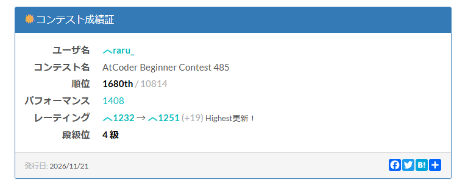
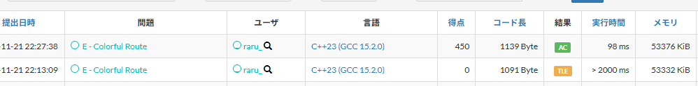
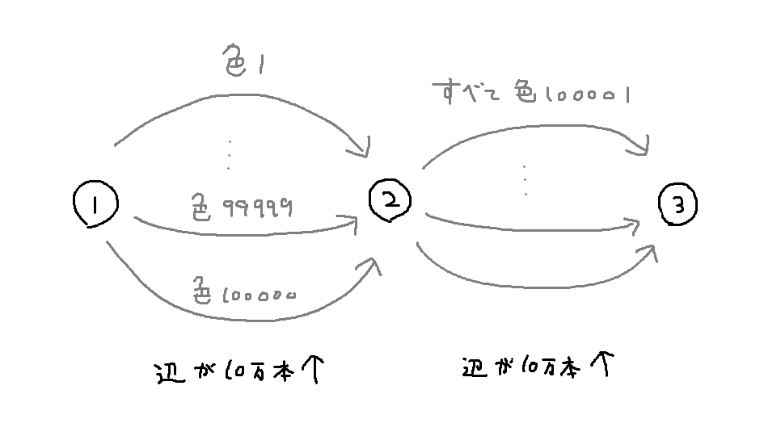

[AtCoder Beginner Contest 485](https://atcoder.jp/contests/abc485) に参加していました！

3週ぶりの振り返り記事です。前々回はそもそも参加していなかったためで、前回はまともに解けた問題がA, B問題しかなかったためです…。むしろ、そういう回こそ振り返るべきなのかもしれない。

結果は A~E の5完で、順位は1680位でした。以下から振り返りです。



https://x.com/rarula_/status/2124139390469656605?a=6n-R6yVYCUngUVxf8TI&s=20

## A - Same Side
[問題](https://atcoder.jp/contests/abc485/tasks/abc485_a)

`sgn` 関数を定義して実装。

<details>
<summary>提出コード</summary>

```cpp
#include <bits/stdc++.h>
#define endl '\n'
using namespace std;
using ll = long long;

ll sgn(ll a) {
    if (a > 0) return 1;
    if (a < 0) return -1;
    return 0;
}

int main() {
    cin.tie(nullptr);
    ios_base::sync_with_stdio(false);

    ll A, B;
    cin >> A >> B;
    if (sgn(A) == sgn(B)) {
        cout << "Yes" << endl;
    } else {
        cout << "No" << endl;
    }

    return 0;
}
```
</details>

## B - Faucets and Drains
[問題](https://atcoder.jp/contests/abc485/tasks/abc485_b)

問題文の通りに文字列を1つずつ確認していきます。

<details>
<summary>提出コード</summary>

```cpp
#include <bits/stdc++.h>
#define endl '\n'
using namespace std;
using ll = long long;

int main() {
    cin.tie(nullptr);
    ios_base::sync_with_stdio(false);

    ll N, M;
    cin >> N >> M;
    vector<string> S(N);
    for (int i = 0; i < N; i++) cin >> S[i];

    for (int i = 0; i < N; i++) {
        if (S[i] == string(M, 'x')) {
            cout << "Faucet " << i+1 << endl;
            return 0;
        }
        for (int j = 0; j < M; j++) {
            if (S[i][j] == 'x') {
                cout << "Drain " << j+1 << endl;
                return 0;
            }
        }
    }

    return 0;
}
```
</details>

## C - Different Neighbor
[問題](https://atcoder.jp/contests/abc485/tasks/abc485_c)

各 $i$ について実際に左方向と右方向に異なる色の点を探しにいってみて、それらとの距離の最小値を答えればよいです。

異なる点を探す際に時間をかけていられないですが、予めランレングス圧縮しておくと左右に1つずれた位置を見に行くだけで良さそうなので、その方針で実装。

<details>
<summary>提出コード</summary>

```cpp
#include <bits/stdc++.h>
#define endl '\n'
using namespace std;
using ll = long long;

int main() {
    cin.tie(nullptr);
    ios_base::sync_with_stdio(false);

    ll N;
    cin >> N;
    vector<ll> C(N);
    for (int i = 0; i < N; i++) cin >> C[i];

    vector<pair<ll,ll>> rle;
    rle.emplace_back(C[0], 1);

    vector<ll> rle_idx(N);
    rle_idx[0] = 0;

    for (int i = 1; i < N; i++) {
        if (rle.back().first == C[i]) {
            rle.back().second++;
        } else {
            rle.emplace_back(C[i], 1);
        }
        rle_idx[i] = rle.size() - 1;
    }

    const ll INF = 1LL << 60;
    ll len = rle.size();
    vector<ll> mn(len, INF), mx(len, -INF);
    for (int i = 0; i < N; i++) {
        mn[rle_idx[i]] = min(mn[rle_idx[i]], i + 1LL);
        mx[rle_idx[i]] = max(mx[rle_idx[i]], i + 1LL);
    }

    for (int i = 0; i < N; i++) {
        ll idx = rle_idx[i];
        ll ans = INF;
        if (idx >= 1) ans = min(ans, (i+1) - mx[idx - 1]);
        if (idx < len-1) ans = min(ans, mn[idx + 1] - (i+1));
        cout << ans << endl;
    }

    return 0;
}
```
</details>

## D - ABC|ABC|ABC
[問題](https://atcoder.jp/contests/abc485/tasks/abc485_d)

$i$ を固定した状況を考えます。このとき3つの部分文字列が `A`, `B`, `C` をすべて含むような最小の $j$ と最大の $j$ がわかれば、答えへの寄与はその差から求められそうです。

「 $i$ 文字目以降で `A`, `B`, `C` をすべて含む最初の位置はどこか？」を求める必要があって、これは予めnext配列を作っておくことで対応しました。

累積和を利用して部分文字列が `A`, `B`, `C` をすべて含むか確認していたりと、最終的に色々行き当たりばったり感のある実装になりました。通ってよかった。

<details>
<summary>提出コード</summary>

```cpp
#include <bits/stdc++.h>
#define endl '\n'
using namespace std;
using ll = long long;

// from https://github.com/rarula/atcoder-templates
// next[i][c] := 文字列 s の i 文字目を含めたそれ以降で、文字 c が出現する最小の添え字 (存在しないときは -1)
vector<vector<ll>> make_next(const string &s) {
    ll n = s.size();
    vector<vector<ll>> res(n+1, vector<ll>(26, -1));
    for (int i = n-1; i >= 0; i--) {
        res[i] = res[i+1];
        res[i][s[i] - 'A'] = i; // 英子文字 a~z にのみ対応 (英大文字 A~Z に対応するには 'A' に変更)
    }
    return res;
}

int main() {
    cin.tie(nullptr);
    ios_base::sync_with_stdio(false);

    ll N;
    cin >> N;
    string S;
    cin >> S;

    S = 'Z' + S;
    auto nxt = make_next(S);

    vector<ll> a(N+1, 0), b(N+1, 0), c(N+1, 0);
    for (int i = 1; i <= N; i++) {
        if (S[i] == 'A') a[i]++;
        if (S[i] == 'B') b[i]++;
        if (S[i] == 'C') c[i]++;
    }
    for (int i = 1; i <= N; i++) {
        a[i] += a[i-1];
        b[i] += b[i-1];
        c[i] += c[i-1];
    }

    ll max_r = -1; // [1, l) [l, max_r) [max_r, N+1)
    bool ok_a = false;
    bool ok_b = false;
    bool ok_c = false;
    for (int i = N; i >= 1; i--) {
        if (S[i] == 'A') ok_a = true;
        if (S[i] == 'B') ok_b = true;
        if (S[i] == 'C') ok_c = true;
        if (ok_a && ok_b && ok_c) {
            max_r = i;
            break;
        }
    }

    ll ans = 0;
    for (int i = 1; i <= N; i++) {
        ll l = i; // [1, l) [l, max_r) [max_r, N+1)
        if (a[l-1] >= 1 && b[l-1] >= 1 && c[l-1] >= 1) {
            ll r = -1;
            if (S[i] == 'A' && nxt[i][1] != -1 && nxt[i][2] != -1) r = max(nxt[i][1], nxt[i][2]);
            if (S[i] == 'B' && nxt[i][0] != -1 && nxt[i][2] != -1) r = max(nxt[i][0], nxt[i][2]);
            if (S[i] == 'C' && nxt[i][0] != -1 && nxt[i][1] != -1) r = max(nxt[i][0], nxt[i][1]);
            if (r == -1) continue;
            if (r < max_r) {
                if (a[max_r-1] - a[l-1] >= 1 && b[max_r-1] - b[l-1] >= 1 && c[max_r-1] - c[l-1] >= 1) {
                    ans += max_r - r;
                }
            }
        }
    }

    cout << ans << endl;
    return 0;
}
```
</details>

## E - Colorful Route
[問題](https://atcoder.jp/contests/abc485/tasks/abc485_e)

考えていくと、頂点 $v$ に異なる2色の辺を通って遷移できるとき、頂点 $v$ から他の頂点へ向かう遷移は全部網羅できそうです。つまり、各頂点ではBFSによる遷移が早かった上位2色だけを考えればよく、3色目以降は遷移を省いても影響がなさそうだなと感じます。ただ、省くことで何かが改善してるようには見えませんでした…。

よくわからなかったので、ひとまず愚直に「どの色の辺を通って来たか？」の状態を持って遷移していく拡張BFSを考えることにします。

単純に色の種類数だけ状態を持つことにすると空間計算量がやばそうですが、連想配列で持てば空間は $O(N + M)$ に抑えられそう。時間計算量のほうも考えますが、これでも問題なく通るような気がしました。

サンプルが通ったので提出してみると、一瞬で [TLE](https://atcoder.jp/contests/abc485/submissions/81006629) の表示に変わってつらくなります。

実装を再確認しても無限ループに陥ることはなさそうだったので、恐らく特定のケースで問題がありそう。が、何度考え直しても問題のありそうなケースが見えなかったので、悪あがきに枝刈りのつもりで3色目以降の遷移を省いた実装を提出してみます。



や、 [AC](https://atcoder.jp/contests/abc485/submissions/81011431) してしまった…。

<details>
<summary>提出コード</summary>

```cpp
#include <bits/stdc++.h>
#define endl '\n'
using namespace std;
using ll = long long;

int main() {
    cin.tie(nullptr);
    ios_base::sync_with_stdio(false);

    ll N, M;
    cin >> N >> M;
    using P = pair<ll,ll>; // nv, edge color
    vector<vector<P>> g(N);
    for (int i = 0; i < M; i++) {
        ll u, v, c;
        cin >> u >> v >> c;
        u--;
        v--;
        g[u].push_back(make_pair(v, c));
    }

    vector<unordered_map<ll,ll>> dist(N);
    dist[0][0] = 0;

    queue<P> q; // v, color
    q.push(make_pair(0, 0));

    while (q.size()) {
        auto [v, c] = q.front();
        q.pop();
        ll d = dist[v][c];
        for (auto [nv, ec] : g[v]) {
            if (ec == c) continue;
            if (dist[nv].count(ec)) continue;
            if (dist[nv].size() >= 2) continue;
            dist[nv][ec] = d + 1;
            q.push(make_pair(nv, ec));
        }
    }

    const ll INF = 1LL << 60;
    ll ans = INF;
    for (auto [ec, d] : dist[N-1]) {
        ans = min(ans, d);
    }

    if (ans == INF) ans = -1;
    cout << ans << endl;
    return 0;
}
```
</details>

---

### コンテスト終了後

コンテストが終わって [mint](/members/mint/) と感想を話し合っているとき、このケースで $O(M^2)$ になって落ちることに気が付きました。それはそう。



## F - Big Bridge
[問題](https://atcoder.jp/contests/abc485/tasks/abc485_f)

うまく差分更新ができるのかと思ったけれど、 $j = 0$ のときを解く方法しか分からず…。

## 総括
パフォーマンスは1408、レーティングは1232→1251(+19)となりました。

1400パフォーマンスを出してもレーティングが19しか増えないことに驚愕。やばい世界。  
青色を目標に取り組んでいるけど、この上がり幅で到達できるのか…？？？になっています。頑張るしかない。
