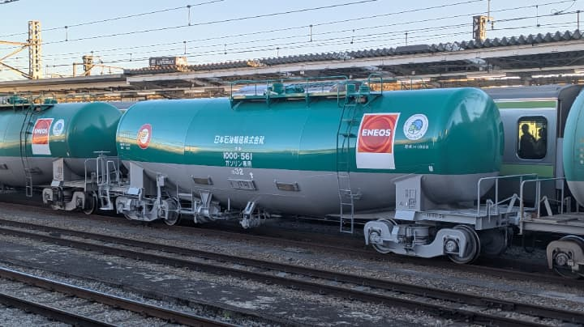
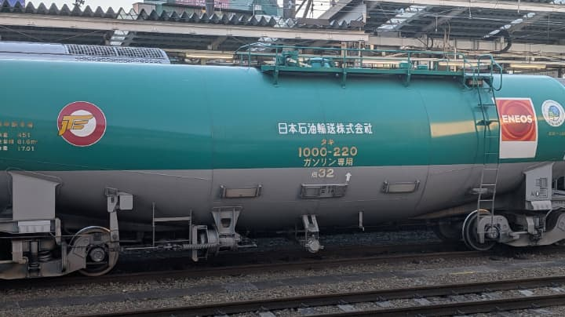
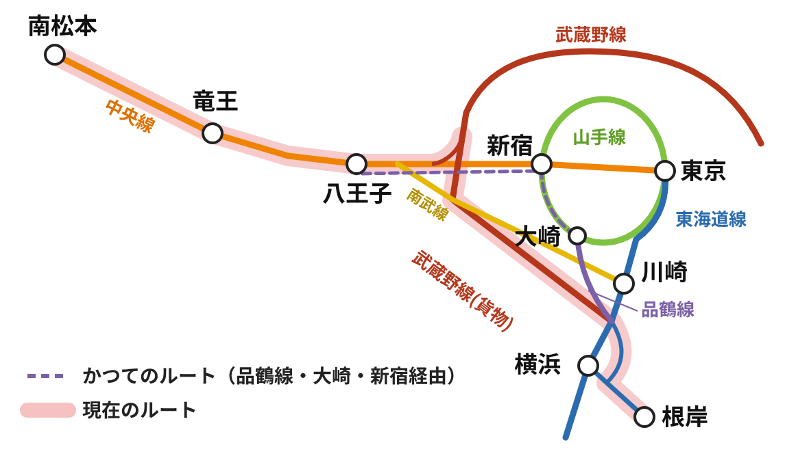
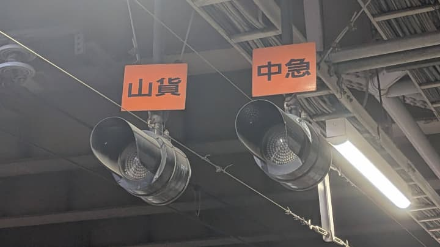

## 八王子駅に止まっていたタンク車
  
東京都の西にある八王子駅。ホームで電車を待つ二人の向かいの線路に、長い貨物列車が止まっていた。  
  

  
たかし： あ！貨物列車だ！おぉ、長いな。丸いタンクみたいな車両がずっとつながってる。  
みのり： タンク車だね。何両あるか数えてみる？  
たかし： 1、2、3……全部で17両か。どれも同じ形だなあ。中に何が入ってるんだろう。水かな？  
みのり： タンクの側面を見てみて。「ガソリン専用」って書いてあるよ。  
たかし： ほんとだ。ガソリンって列車でも運ぶんだね。ずっとタンクローリーで運ぶものだと思ってた。  
みのり： 遠くまで一度にたくさん運ぶときは、列車の出番なんだよ。  
たかし： じゃあ目の前に、ガソリンが17両分もあるってこと？ なんだかちょっと緊張するな。  
  

  
## タンクの中身
みのり： 大丈夫、あのタンク、今はほとんど空っぽだから。  
たかし： 空？ 外からは中身なんて見えないのに、なんで分かるの？  
みのり： 機関車がどっち側についているか見てみて。  
たかし： 機関車って、先頭の青いやつだよね。あっち側……東京のほうを向いてる。  
みのり： そう。つまりこの列車は、反対側の山のほうから来て、これから東京へ向かうところ。  
たかし： うーん、東京に向かっていると、どうして空だって分かるの？  
みのり： ガソリンは何からつくるか覚えてる？  
たかし： 石油……えっと、原油だよね。外国から船で運んでくるやつ。  
みのり： そう。だから原油をガソリンに変える工場は、船が着く海のそばにしかないの。  
たかし： あ、そうか！ 海のそばの工場から出発するなら、山へ向かうときが満タンで、海へ戻るときは中身を降ろした帰り道ってことか。  
みのり： 大正解。この列車はたぶん、長野県の松本あたりでガソリンや灯油を降ろしてきた帰りだね。灯油は冬のストーブに使う油。  
たかし： せっかく戻るなら、空っぽのままじゃなくて長野の特産品でも積んで帰ればいいのに。りんごジュースとか。  
みのり： ガソリンを入れていたタンクにジュースは入れられないでしょう。  
たかし： それもそうか。ちなみに、満タンのときはどれくらい入ってるの？  
みのり： 1両でおよそ45トン。17両だと700トンを超えるよ。大きなタンクローリーの数十台分だね。  
たかし： これ1本で、道路を走るタンクローリー数十台分か……。  

## どこから来てどこへ行く？
  
たかし： 空になったタンク車は、これからどこへ帰るの？  
みのり： 次にガソリンを積む場所。さっき言った海のそばの工場、「製油所」へ戻るの。  
たかし： 東京の海のそばってことは、東京湾のあたり？  
みのり： そう、神奈川県の川崎とか横浜。大きな工場が並んでいる京浜工業地帯のあたりだね。  
たかし： 横浜から長野まで行って、また帰ってくるのか。けっこうな距離だなあ。  
みのり： 片道で200キロ以上あるからね。しかも途中は険しい山の中を通っていくんだよ。  
たかし： 松本に着いたガソリンはどうなるの？ まさか駅でガソリンスタンドの人が待ってるわけじゃないよね。  
みのり： 駅の近くに大きな貯蔵タンクがあって、いったんそこにためておくの。そこからはタンクローリーにバトンタッチして、 長野中のガソリンスタンドへ配っていく。  
たかし： じゃあ、長野で車に入れるガソリンは、この列車が運んだものかもしれないんだ。  
みのり： そういうこと。同じタンク車が、海と山のあいだをずっと行ったり来たりしているのよ。  
  
  
  
## 昔は東京の真ん中を通っていた
  
たかし： 横浜へ帰るなら、このあと新宿とか東京の真ん中を通っていくの？  
みのり： 今は通らないよ。途中で別の線路に入って、東京の外側を大きく回っていくんだ。  
たかし： 「今は」ってことは、昔は真ん中を通ってたの？  
みのり： そう、通ってた。新宿まで行って、そこから山手線に入っていたんだよ。（※）  
たかし： 山手線って、東京の真ん中をぐるぐる回ってるあの環状線の電車？ あんな混んでるところを貨物列車が走ってたの？  
みのり： 実はね、山手線はもともと貨物列車のために作られた線路なんだよ。  
たかし： えっ、そうなの？ 人が乗る電車じゃなかったんだ。  
みのり： できたのは1885年、明治時代。そのころ、東京から横浜へ行く線路と、東京から北へ行く線路はつながっていなかったの。今で言う上野～東京間だね。  
たかし： つながってないと、何が困るの？  
みのり： 群馬県の富岡製糸場って聞いたことあるよね。あそこで作った生糸を、横浜の港から船でアメリカへ輸出していたんだけど、当時はそれが日本のいちばん大事な産業だったの。  
たかし： 北から運んできた糸を横浜の港へ運びたいのに、東京で線路が途切れていたのか。  
みのり： そう。その二つの線路をつなぐために作られたのが、山手線の始まり。  
たかし： 最初は人じゃなくて、糸を運ぶためのバイパスだったんだ。  
みのり： もちろん人も乗せていたけど、いちばんの目的は貨物だったの。そのあと東京に住む人が増えて、山手線は今みたいな満員電車が走るようになった。  
たかし： そうなると、のんびり走る貨物列車が邪魔になるよね。  
みのり： だから山手線のすぐ隣に、貨物列車専用の線路をもう一組敷いたの。湘南新宿ラインって乗ったことある？  
たかし： あるよ。新宿から横浜のほうへ行く電車でしょ。  
みのり： 実はあれは愛称で、新宿のあたりを走っている線路自体には別の名前があるんだ。「山手貨物線」っていうの。  
たかし： えっ、今も「貨物線」って名前なの？  
みのり： そう。昔は貨物列車しか走らなかった線路を、今は人を乗せる電車が使っているの。線路脇の信号機を見ると、今でも「山貨（やまか）」って文字が残ってるよ。  
  

<small>山貨=山手貨物線、中急=中央急行線</small>
  
たかし： じゃあ、肝心の貨物列車は今どこを走ってるの？  
みのり： その線路も電車でいっぱいになったから、1970年代に東京のさらに外側を回る線路を新しく作ったの。今の武蔵野線だね。貨物列車はそっちへ引っ越したってわけ。  
たかし： 混んでる都心部をよけて、外側に新しいルートをどんどん作ってきたんだ。  
みのり： そう。山手線も、できた当時は街の外側を回る線路だったの。東京という街が大きくなるにつれて、木の年輪みたいに、もう一つ外側に同じ役目の線路が必要になったんだね。  
たかし： へえ、面白いなあ。でも武蔵野線も、最近は朝の混雑がすごいって聞くよ。数十年後には、さらにその外側に新しい貨物線ができているかもしれないね。  
  
## トラックに置き換わらなかった理由
  
たかし： でもさ、今の時代って荷物はだいたいトラックで運ぶよね。ガソリンも最初からタンクローリーで運べばよくない？  
みのり： 日本全体で見ると、列車で運ぶ石油は1割もないよ。ほとんどは船とタンクローリー。  
たかし： やっぱりそうなんだ。  
みのり： じゃあ、長野県で使われる石油のうち、列車で運ばれてくるのは何割くらいだと思う？  
たかし： 全体で1割ないなら……長野も1割くらい？  
みのり： およそ8割。  
たかし： 8割！？ ほとんど列車じゃん。なんで長野だけそんなに多いの？  
みのり： 長野だけじゃなくて、群馬県や栃木県も同じくらい。この三つの県に共通すること、なんだと思う？  
たかし： えーっと……あ、どれも海がない県だ！  
みのり： その通り。海がないから、船で運べないの。残る選択肢は列車かタンクローリー。もしこの列車1本分のガソリンをタンクローリーで運ぶとしたら、どうなると思う？  
たかし： さっき数十台分って言ってたから……運転手も数十人必要になるね。  
みのり： それが毎日。しかも険しい山道を200キロ以上走るし、冬は雪も降る。ストーブの灯油がいちばん必要になるのも冬なのにね。  
たかし： たしかに、雪の山道を毎日何十台も走るのは大変だ。列車なら1本でまとめて運べるもんな。  
みのり： だから長い距離は列車がまとめて運んで、最後の短い距離だけをタンクローリーが配る。  
たかし： トラックに負けたんじゃなくて、得意なところを分け合ってるんだね。  
みのり： たくさんの荷物を、遠くまで、毎日同じ場所へ運ぶ。そういう仕事は、今も列車のほうがずっと向いているんだよ。  
  
## 列車を見送って
  
青い機関車がゆっくりと動き出し、空のタンク車が1両ずつ二人の前を通り過ぎていく。  
  
たかし： 行っちゃった。最初はただの長い貨物列車だと思ってたけど、話を聞いたらなんだか見え方が変わったな。  
みのり： どう変わった？  
たかし： 機関車の向きひとつで「今は空っぽだ」って推理できるし、帰る先の横浜や、昔走ってた山手線の歴史までつながってる。たった1本の列車なのに、いろんな背景が見えるね。  
みのり： 普段なにげなく見ている風景でも、どこから来てどこへ行くのかをたどってみると、街がどうやってできたのかまで見えてくるんだよね。  
たかし： あのタンク車、次はいつここを通るんだろう。  
みのり： ガソリンを積んだら、また松本へ向かうよ。今度は満タンでね。  
  
たかしはその後、やけに得意げな顔で残りの一日を過ごしたのだった。  
  
## あとがき
  
いかがだったでしょうか。今回は趣向を変えて、会話調で記事を書いてみました。たかしくんは、好奇心旺盛な小学生という設定です。実際、小中学生の年代にこのような話をすると、大変面白がって話を聞いてくれます。  
  
※ 根岸・川崎から八王子を経由する石油貨物列車が、実際に過去に新宿経由で運転されていたかどうかは不明です。南武線経由である可能性もありますが、今回はものがたりの都合上、新宿経由であったとしています。